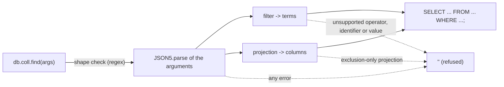

# mongodb-to-sql-translator

Turns a MongoDB shell `find()` call into a single SQL `SELECT` statement. Use it as a TypeScript/JavaScript library or as the `mongo-to-sql` command.

It handles a deliberately small subset: equality, comparisons, `$in`, `$and`/`$or`, null checks and inclusion projections. Anything outside that subset is refused as a whole. It never returns a partial translation that would quietly change the meaning of the query. It never connects to MongoDB or to a SQL database.

## Quick start

Requires Node.js 22.13 or newer (`.nvmrc` pins 22).

```sh
npm ci
npm test            # Vitest: unit, edge-case, CLI and SQLite-execution suites
npm run build       # compiles src/ to dist/ with type declarations
npm run example     # builds, then runs examples/translate.cjs
```

`npm run lint` (ESLint, type-aware) and `npm run typecheck` cover `src/` and the tests.

## Library

```js
const { convertToSQL } = require('mongodb-to-sql-translator'); // or require('./dist') in a checkout after npm run build

convertToSQL('db.users.find({age: {$gte: 21}, active: true}, {name: 1, _id: 1});', true);
// SELECT name, id FROM users WHERE age >= 21 AND active = TRUE;
```

The second argument, `removeUnderscoreBeforeID` (default `false`), renames the `_id` field to `id` in filters and projections. Unsupported or malformed queries return `''`. A non-string argument throws.

The examples below were captured from a run of the built package:

| MongoDB | SQL |
| --- | --- |
| `db.users.find({$or: [{age: {$gte: 21}, active: true}, {name: "Sample"}]});` | `SELECT * FROM users WHERE ((age >= 21 AND active = TRUE) OR name = 'Sample');` |
| `db.order.find({status: {$in: ["placed", "paid"]}, total: {$gt: 100}}, {_id: 0, customer: 1});` | `SELECT customer FROM "order" WHERE status IN ('placed', 'paid') AND total > 100;` |
| `db.users.find({nickname: null, email: {$ne: null}});` | `SELECT * FROM users WHERE nickname IS NULL AND email IS NOT NULL;` |
| `db.users.find({name: "O'Brien", note: "C:\\tmp\\"});` | `SELECT * FROM users WHERE name = 'O''Brien' AND note = 'C:\tmp\';` |
| `db.user.find({select: 1, Group: "a"}, {from: 1});` | `SELECT "from" FROM "user" WHERE "select" = 1 AND "Group" = 'a';` |
| `db.users.find({name: {$regex: "^A"}});` | `''` (unsupported operator) |
| `db.users.find({}).limit(5);` | `''` (method chains are not translated) |
| `db.users.find({id: 12345678901234567890});` | `''` (the number cannot be represented exactly) |

## Command line

In a checkout, run `npm run build` first. Then:

```sh
node dist/bin.js 'db.users.find({age: {$gt: 30}}, {name: 1});'
# SELECT name FROM users WHERE age > 30;

echo 'db.users.find({_id: 7}, {email: 1});' | node dist/bin.js --rename-id
# SELECT email FROM users WHERE id = 7;

node dist/bin.js 'db.users.find({a: {$where: 1}});'
# mongo-to-sql: unsupported or malformed query   (stderr, exit code 1)
```

When the package is installed as a dependency, the same command is available as `mongo-to-sql` (for example `npx mongo-to-sql ...` from the consuming project).

The query comes from the single argument, or from stdin when there is no argument. Exit codes: `0` translated, `1` refused, `2` usage error. `--help` prints the usage.

## Supported subset

| Input | SQL |
| --- | --- |
| `field: value` (string, finite number, boolean) | `field = value` |
| `$eq`, `$ne`, `$lt`, `$lte`, `$gt`, `$gte` | `=`, `!=`, `<`, `<=`, `>`, `>=` |
| Several operators on one field | Joined with `AND` |
| `$in` with a non-empty list of non-null scalars | `IN (...)` |
| `$and`, `$or` (nested up to 20 levels) | Parenthesised groups. An operand with several fields stays grouped. |
| `field: null`, `$eq: null`, `$ne: null` | `IS NULL`, `IS NOT NULL` |
| Projection fields set to `1`, optionally `_id: 0` | Explicit column list |
| `{}` filter and no projection | `SELECT * FROM collection;` |

Everything else is refused, including:

- other operators (`$regex`, `$exists`, `$nin`, `$not`, `$nor`, `$elemMatch`, `$where`, ...)
- dotted paths and nested document values
- `ISODate()`, `new Date()` and regex literals
- exclusion-only projections
- method chains like `.limit()` and `.sort()`
- an empty `$in`
- ordering comparisons against `null`
- `NaN`, `Infinity`, and integers beyond ±2^53
- strings containing NUL
- more than two arguments
- inputs over 100,000 characters

How the input is handled:



The arguments are parsed with JSON5, so unquoted keys and single-quoted strings work as they do in the shell. No JavaScript is evaluated. All validation lives in `src/MongoDBToSQLTranslator.ts`. `src/index.ts` is the public entry point, and `src/cli.ts`/`src/bin.ts` are the command.

## SQL dialect

The output is standard SQL as PostgreSQL and SQLite read it:

- **Identifiers.** Collection and field names must match `[A-Za-z_][A-Za-z0-9_]*`, so non-ASCII names are refused. Names that are reserved words in PostgreSQL or SQLite (`order`, `user`, `select`, `group`, ...) are wrapped in double quotes with their case kept. All other names are left unquoted, which means PostgreSQL folds them to lower case: a Mongo field `createdAt` is read as column `createdat`.
- **Strings.** Strings are single-quoted, and an embedded `'` is doubled. Backslash has no special meaning. That holds for PostgreSQL (`standard_conforming_strings = on`, the default) and SQLite. It does **not** hold for MySQL or MariaDB unless `NO_BACKSLASH_ESCAPES` is set: there, a value ending in a backslash would escape the closing quote. Do not feed the output to MySQL.
- **Booleans and null.** Booleans are written as `TRUE`/`FALSE`, and null tests as `IS NULL`/`IS NOT NULL`.

`__tests__/sqlite.test.ts` executes the generated SQL on an in-memory SQLite database (`node:sqlite`). It uses fast-check property tests to show three things:

- any string, including quotes, comment markers and emoji, matches exactly the row that stores it
- `$in` lists of hostile strings select exactly the listed rows
- finite doubles round-trip through the literal

## Limits worth knowing

This is a translator for inspection and learning, not a MongoDB compatibility layer:

- MongoDB's missing-field, array and type-bracketing semantics differ from SQL's. For example, `{$ne: 5}` in MongoDB also matches documents without the field, while `!= 5` excludes NULL rows.
- Projections do not reproduce MongoDB's implicit `_id` inclusion.
- There is no schema knowledge, so an exclusion projection cannot be expanded into columns.
- Values are inlined as literals. For a database-facing system, prefer parameterised queries built by your driver. The escaping here is tested, but it is specific to the dialect above.

## License

ISC, see [LICENSE](LICENSE).
